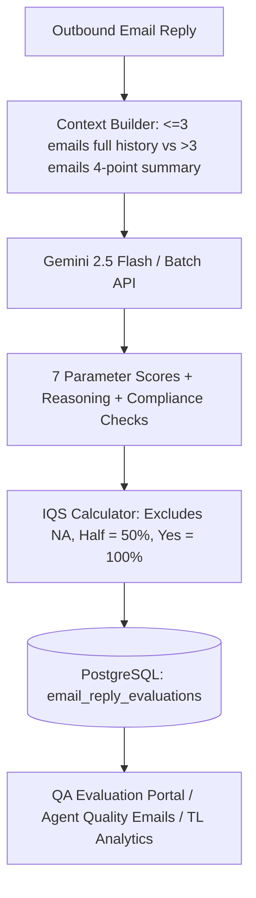

# Wint Wealth Email Evaluation: Parameters, Prompts & Scoring Specifications

This document serves as the official specification for all **7 Email Quality Parameters, Scoring Rubrics, Mathematical Formulations, and Prompt Blueprints** used across the Wint Wealth IR Portal email evaluation engine.

---

## Table of Contents
1. [Overview & Architecture](#1-overview--architecture)
2. [The 7 Email Quality Parameters & Weights](#2-the-7-email-quality-parameters--weights)
3. [Detailed Scoring Rubrics (Yes / Half / No / NA)](#3-detailed-scoring-rubrics)
   - [Parameter 1: Issue resolution](#parameter-1-issue-resolution)
   - [Parameter 2: Accuracy](#parameter-2-accuracy)
   - [Parameter 3: Expectation setting](#parameter-3-expectation-setting)
   - [Parameter 4: Personalisation](#parameter-4-personalisation)
   - [Parameter 5: Empathy](#parameter-5-empathy)
   - [Parameter 6: Sentences (Simple to understand)](#parameter-6-sentences-simple-to-understand)
   - [Parameter 7: Opening and closing message](#parameter-7-opening-and-closing-message)
4. [IQS Mathematical Formulation](#4-iqs-mathematical-formulation)
5. [Compliance Tripwire Gates](#5-compliance-tripwire-gates)
6. [Gemini Evaluation Prompt Specification](#6-gemini-evaluation-prompt-specification)
7. [Codebase Implementation Reference](#7-codebase-implementation-reference)

---

## 1. Overview & Architecture

Email quality evaluation scores each outbound agent reply in a customer ticket independently. Evaluations are conducted automatically through the Gemini Batch API (scheduled at 3:00 PM and Overnight), on-demand via synchronous evaluation, and can be reviewed or overridden by QA Specialists.



---

## 2. The 7 Email Quality Parameters & Weights

| # | Parameter Name | Key | Default Weight | NA Allowed? | Core Focus |
|---|----------------|-----|:--------------:|:-----------:|------------|
| 1 | **Issue resolution** | `issue_resolution` | **25%** | Yes | Addresses every question/request; moves the issue forward with clear next steps. |
| 2 | **Accuracy** | `accuracy` | **25%** | No | Information is factual, compliant, correct product named, disclaimers present, documents attached & verified. |
| 3 | **Expectation setting** | `expectation_setting` | **15%** | No | Clear process, realistic TATs, personalized follow-ups, educational points. |
| 4 | **Personalisation** | `personalisation` | **10%** | No | Tailored to client's actual case, references specific details, avoids asking for info already shared. |
| 5 | **Empathy** | `empathy` | **10%** | Yes | Understands customer stakes and emotions (especially when money is involved), warmth, calms irritated clients. |
| 6 | **Sentences (Simple to understand)** | `sentences_simple_to_understand` | **10%** | No | Short sentences, no jargon, key details emphasized (bold/italics), error-free, conversational. |
| 7 | **Opening and closing message** | `opening_and_closing` | **5%** | No | Natural greeting and sign-off tied to case context; avoids stacked boilerplate. |
| | **Total** | | **100%** | | |

---

## 3. Detailed Scoring Rubrics

### Parameter 1: Issue resolution
*Does the email address every question and request raised by the customer and either resolve the issue or properly move it forward?*

#### What to check
- Every question and request is addressed, not just the first one. Nothing is skipped, including anything left open from earlier emails. The issue is either resolved or the customer is given a clear next step, so they are never left without guidance.
- If the agent says they will check or follow up, the reply explains what will happen next. Mentioning *"our team"* or *"the concerned team"* is acceptable; the team does not need to be named specifically.
- If the customer shares a document, screenshot, account update, or confirmation without asking a direct question, the agent acknowledges it and takes the appropriate next step.
- The customer is not left without guidance on what to do next.

#### Scoring Criteria
- **Yes (100%)**: Every question and request is addressed, and the issue is resolved or properly progressed. Examples include raising a ticket, escalating the case, forwarding a document, arranging a call, or giving the customer a clear next step.
- **Half (50%)**: The main issue is addressed, but a smaller question or request is missed or only partly answered, or the next step is unclear.
- **No (0%)**: A key question or request is missed, the reply does not address the customer's actual concern, or the issue is left unresolved without a clear next step.
- **NA (Excluded)**: There is no customer issue to resolve. Applies to: a general announcement, routine update, survey, policy notification; standard auto-closure notice sent because customer did not reply; email not to a client. (Auto-closures are never scored as an unresolved issue).

---

### Parameter 2: Accuracy
*Whether everything the agent told the client is correct, compliant and safe, and whether any document the agent sent is the right one. Every agent reply in a ticket is scored separately. Customer messages, internal notes and automated messages are not scored.*

#### What to check (no separate points)
1. Facts, dates, amounts and steps are correct.
2. The correct product is named.
3. Every explanation or educational point (how a product works, rules, charges, offer terms, timelines) is correct.
4. No guaranteed returns, predictions or personal investment advice.
5. Required disclaimers are included.
6. Only the client's own details are shared.
7. The document (statement, certificate, form, confirmation) is actually attached.
8. The email says a document is attached and names it.
9. It is the right document, and it belongs to this client.  
*(Checks 7, 8 and 9 apply only when the reply sends a document. If no document is involved, they are N/A).*

#### Operational Guidelines
- **Client-specific facts** (amounts, dates, bond held, order or account status, bank details, IDs): account data first, then the attachment, then the thread.
- **General rules** (how a product works, charges, TDS, settlement cycles, steps, TATs, offer terms, app paths): the knowledge base (KB).
- **Claims about the thread** (*“as shared in our earlier email”*): the thread itself.
- **Essential information must be restated**: Amount, date and time, transaction reference, and document or reward details must appear in the current reply itself. If the reply points to an earlier email for these details instead of restating them, score **No**, whether or not the earlier email exists.
- **Conflict rule**: Account data wins for client facts and the KB wins for general rules.
- **No external speculation**: Never mark something right or wrong from personal knowledge of the product, SEBI rules, or tax.
- **Unverified claims**: If a claim cannot be checked against any source, note it as unverified and route for human QA review.
- **Past errors**: A reply is judged against facts as they are now known. Repeating an earlier error is scored down; correcting an earlier error is not.

#### Scoring Criteria
- **Yes (100%)**: All applicable checks pass. Information is accurate, right product named, no guarantees/predictions/personal advice, required disclaimer present, only client's own details shared, and any attachment is present, named, and correct.
- **Half (50%)**: A minor lapse that does not mislead the client or cause harm. Examples: a wording slip that does not change the meaning; a footer missing on a Tier B reply where everything else is correct and safe; an attachment mentioned only loosely, or attached but never mentioned; a detail of another account whose origin cannot be shown (also send for human review).
- **No (0%)**: Any one of these: a wrong fact, date, amount, step, TAT, offer term or explanation that could mislead the client or lead to a wrong action; the wrong product named; a guaranteed return, prediction or personal advice, even if softly phrased; another client's details shared, or details sent to someone who is not the account holder; a required disclaimer missing on a Tier A reply; a core attachment missing, wrong, or belonging to another client; a false statement about the thread that sends the client looking for something that does not exist; essential information (amount, date/time, transaction reference, document or reward details) not restated, with the reply only pointing to an earlier email.

---

### Parameter 3: Expectation setting
*The agent answers the user's core query completely and shares all related information without waiting to be asked. The user should leave knowing exactly what happens next and by when.*

#### What to check
- If the agent asks a question and the user doesn't reply, the agent still gives a generic response and tries to move the query toward resolution.
- If the user isn't understanding, the agent reframes in simpler words until they do.
- The correct process and a realistic TAT are always stated. *Example (missed interest repayment):* ask user to first check their bank statement (sharing last 4 digits of the bank account). If not credited, ask them to send the statement to our registered email, and set a TAT for the check and for any further escalation.
- **Repayment Exception**: For repayment cases where a specific TAT cannot be defined, the agent should communicate available information and explain next steps without committing to an unrealistic timeline. Marks should not be deducted under Expectation Setting solely because a specific TAT cannot be provided in such cases.
- Follow-ups are personalized to the user's specific query, not generic.
- Read earlier emails on the thread, and if anything said earlier was wrong or unclear, correct it in this email without being asked.
- Give helpful educational points the client did not ask for (what happens next, how long it takes, charges, rules, what to expect).

#### Scoring Criteria
- **Yes (100%)**: Complete answer, correct process, clear TAT wherever applicable, and personalised follow-up.
- **Half (50%)**: Answer is correct, but the process, TAT (where applicable), or follow-up is missing or generic.
- **No (0%)**: Core query unanswered, wrong process, or no expectation set.
- **Exception**: In repayment cases where a specific TAT cannot be defined, do not deduct marks solely for the absence of a specific timeline, provided the agent communicates available information and explains next steps.

---

### Parameter 4: Personalisation
*Is the email written for this client, not a template?*

#### What to check (no separate points)
- Uses the client's actual situation and earlier replies.
- Does not ask for information the client already gave.
- Uses correct pronunciations and terminology (e.g. Finder).
- Refers to the customer's actual bond, amounts, dates or account status; and on a transferred chat, uses what the bot already collected instead of asking the customer to repeat themselves.

#### Scoring Criteria
- **Yes (100%)**: The email reflects the client's actual case. It references their specific details (bond, amounts, dates, account status), builds on earlier replies, and asks for nothing the client has already shared. On a transferred chat, the bot's collected information is used.
- **Half (50%)**: The email is partly tailored but still has template elements. Examples: mentions the client's situation only in general terms, leaves out some relevant details that were available, or includes one minor repeated ask for information that was already given.
- **No (0%)**: The email reads like a template or copy-paste reply. Any of these applies: does not reflect client's actual situation; asks for information the client already gave; ignores earlier replies; makes the client repeat what the bot already collected on a transferred chat.

---

### Parameter 5: Empathy
*The agent understands what the customer is really saying or asking, takes ownership, and responds to the customer's emotion (confusion, worry, anxiety, frustration). Where the customer's money is involved and they have raised a concern about it, this care is expected. The language is warm, polite and natural. The agent calms an irritated customer instead of matching their tone.*

#### What to check
1. **Understanding query**: the reply responds to what the customer actually said, not a generic version of it.
2. **Understanding emotion**: the reply acknowledges the customer's specific feeling or stakes (urgency, frustration, confusion, money at risk) in a fitting way.
3. **Colloquial / too formal**: the tone is natural and professional, neither slangy nor stiff and robotic.
4. **Requesting the user**: any request is polite and comes with a reason, not a command.

#### Scoring Criteria
- **Yes (100%)**: Ownership and warmth are genuine and specific to this customer's situation. At least one sentence acknowledges their actual concern, urgency or feeling in words that could not be pasted into another email.
- **Half (50%)**: The reply is polite and acknowledges the customer, but the acknowledgement is generic or templated, or the warmth comes only from stock courtesy lines that do not name the customer's situation.
- **No (0%)**: The reply is cold, mechanical or dismissive where care is clearly needed, or ignores something the customer said.
- **NA (Excluded)**: When the customer is calm and has raised no worry, complaint, delay or problem, even if money is involved. This includes agent-initiated status updates, confirmations and replies to a simple request.

---

### Parameter 6: Sentences (Simple to understand)
*The response is easy to read, correctly written, and sounds like a real person. All of the following are assessed together as one parameter.*

#### What to check
- **Simple and clear**: Sentences are short and easy to follow, and technical jargon is avoided or explained.
- **Well formatted**: Important details (amounts, dates, TAT, steps) are emphasised with bold, italics, or underline where needed, so the user can find them quickly.
- **Error-free**: There are no spelling mistakes, typos, omitted words, or grammatical errors.
- **Not robotic**: The tone is natural and conversational. The response does not read as a stiff, repeated, or copy-pasted script. Filler and stock phrases in the body of the email are judged here (for example *“We understand your concern”* when the customer raised none). Stock phrases in the opening and closing are judged under Opening and closing.

#### Scoring Criteria
- **Yes (100%)**: All four checks pass. The response is clear, simple, well formatted, error-free, and sounds natural.
- **Half (50%)**: The response is understandable, but one or more of these apply: it is dense, cluttered, or lacks emphasis on key details; it has minor errors that don't affect understanding; it sounds partly scripted or stiff in places; it contains filler or stock phrases in the body that add nothing.
- **No (0%)**: Any one of these happens: the response is confusing, jargon-heavy, or hard to read; errors change the meaning or make the message unclear; the whole response sounds robotic or like a copy-pasted template.

---

### Parameter 7: Opening and closing message
*Evaluate whether the opening and closing messages are natural, personalised, and appropriate to the context of the email thread and the current stage of resolution.*

#### Scoring Criteria
- **Yes (100%)**: The opening and closing are tied to the case, or are a standard pair on a first educational reply. One stock courtesy line is fine when a personal touch is present.
- **Half (50%)**: One stock phrase, and the personal touch is missing or very light.
- **No (0%)**: Multiple stock phrases; a fully generic pair; a repeated sympathy or appreciation line across consecutive emails; or a closing that stacks generic lines after the action is already stated.

---

## 4. IQS Mathematical Formulation

The final **Interaction Quality Score (IQS)** is an integer from 0 to 100% calculated by normalizing earned weight against the sum of active parameter weights:

$$\text{IQS} = \text{round}\left( \frac{\sum_{i \in \text{Active}} w_i \times s_i}{\sum_{i \in \text{Active}} w_i} \right)$$

Where:
- $w_i$ is the parameter weight (25, 25, 15, 10, 10, 10, 5).
- $s_i$ is the mark:
  - $s_i = 1.0$ (100%) for **Yes**
  - $s_i = 0.5$ (50%) for **Half**
  - $s_i = 0.0$ (0%) for **No**
- If a parameter evaluates to **NA** (allowed on *Issue resolution* and *Empathy*), it is completely removed from the set $\text{Active}$ (omitted from both numerator and denominator).

---

## 5. Compliance Tripwire Gates

Regardless of parameter scores, any outbound email is flagged as `compliance_passed: false` if any of the following critical breaches occur:
1. **Guaranteed Returns or Investment Predictions**: Making claims of guaranteed capital or returns.
2. **PII & Data Leakage**: Disclosing another client's details or sending statements to an unverified email.
3. **Misleading Financial Advice / Timelines**: False timelines about SEBI settlements, redemption cycles, or tax rules.
4. **Missing Tier A Mandatory Disclaimers**.
5. **Rude or Unprofessional Language**.

When `compliance_passed: false`, an automated alert is routed to the `#compliance-alerts` Slack channel via [`lib/email/compliance-alert.ts`](file:///Users/admin/Documents/WintWealth/wint-ir-portal/lib/email/compliance-alert.ts).

---

## 6. Gemini Evaluation Prompt Specification

The prompt is constructed dynamically by [`lib/email/context-builder.ts`](file:///Users/admin/Documents/WintWealth/wint-ir-portal/lib/email/context-builder.ts) and submitted to Gemini Batch API:

```json
{
  "quality_score": 88,
  "compliance_passed": true,
  "compliance_issues": [],
  "parameter_scores": {
    "issue_resolution": "yes",
    "accuracy": "yes",
    "expectation_setting": "yes",
    "personalisation": "half",
    "empathy": "na",
    "sentences_simple_to_understand": "yes",
    "opening_and_closing": "yes"
  },
  "parameter_reasoning": {
    "issue_resolution": "Every query regarding TDS deduction was answered completely.",
    "accuracy": "Facts and tax percentages match Wint Wealth KB verbatim.",
    "expectation_setting": "Clear 48-hour TAT stated for updated certificate generation.",
    "personalisation": "Mentioned client's specific bond, but used generic closing lines.",
    "empathy": "NA - Customer had a standard calm administrative request.",
    "sentences_simple_to_understand": "Short, clear sentences with bolded turnaround times.",
    "opening_and_closing": "Contextual opening tied to tax query, single courtesy closing."
  },
  "summary": "Accurate and prompt reply addressing customer questions.",
  "strengths": ["Bolded key turnaround times", "Cites exact portal navigation"],
  "areas_for_improvement": ["Avoid template sign-off"]
}
```

---

## 7. Codebase Implementation Reference

- [`lib/email/context-builder.ts`](file:///Users/admin/Documents/WintWealth/wint-ir-portal/lib/email/context-builder.ts): Source of truth for parameters, weights, prompts, normalization, and IQS calculation.
- [`lib/email/gemini-batch-evaluator.ts`](file:///Users/admin/Documents/WintWealth/wint-ir-portal/lib/email/gemini-batch-evaluator.ts): Gemini Batch & sync evaluation with automatic IQS computation and reasoning capture.
- [`components/quality/EmailEvaluationPage.tsx`](file:///Users/admin/Documents/WintWealth/wint-ir-portal/components/quality/EmailEvaluationPage.tsx): QA review interface with Yes / Half / No / NA toggles and AI reasoning cards.
- [`components/ir/MyQualityEmailsPage.tsx`](file:///Users/admin/Documents/WintWealth/wint-ir-portal/components/ir/MyQualityEmailsPage.tsx): IR Agent portal breakdown and badge rendering.
- [`components/tl/TLEmailQualityPage.tsx`](file:///Users/admin/Documents/WintWealth/wint-ir-portal/components/tl/TLEmailQualityPage.tsx): Team Lead overview with score distributions and parameter breakdown.
- [`scripts/email-parameters.test.ts`](file:///Users/admin/Documents/WintWealth/wint-ir-portal/scripts/email-parameters.test.ts): Unit test suite validating 7 parameters, weights, and scoring logic.
